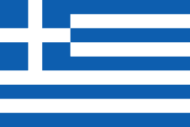
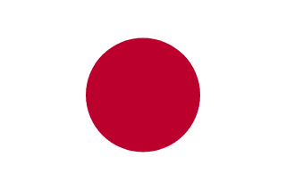

# ✈️ 가고 싶은 여행지

> 다섯 사람이 각자 고른 나라를 소개하는 여행 프로젝트

---

## 🌏 우리의 여행 지도

| 국기 | 나라 | 작성자 | 개인 Markdown |
| :---: | :---: | :---: | :--- |
|  | 영국 | 이원기 | [여행 페이지 →](이원기_영국/UnitedKingdom.md) |
|  | 그리스 | 박주영 | [여행 페이지 →](박주영_그리스/Greece.md) |
|  | 일본 | 정현호 | [여행 페이지 →](정현호_일본/Japan.md) |
|  | 멕시코 | 이윤호 | [여행 페이지 →](이윤호_멕시코/Mexico.md) |
|  | 이탈리아 | 이상민 | [여행 페이지 →](이상민_이탈리아/Italy.md) |

---

## 📝 작성 양식

각자의 폴더 안에 있는 개인 Markdown 파일에 아래 순서로 작성합니다.

1. 나라 소개 · Intro
2. 유명 여행지
3. 유명 음식
4. 자유 주제 단락
5. 마무리 및 본인이 추천하는 코스

사진은 각자 폴더의 `images/`에 넣고 개인 Markdown에서 연결합니다.
현재는 임시 국기 이미지와 빈 작성 양식만 준비되어 있습니다.

국기 이미지: [FlagCDN](https://flagcdn.com/)
