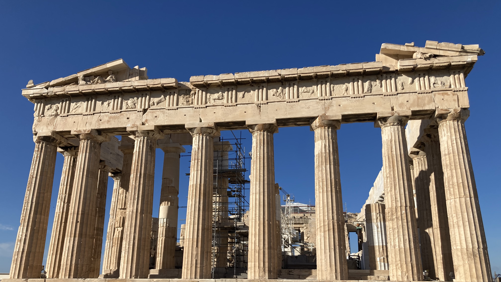
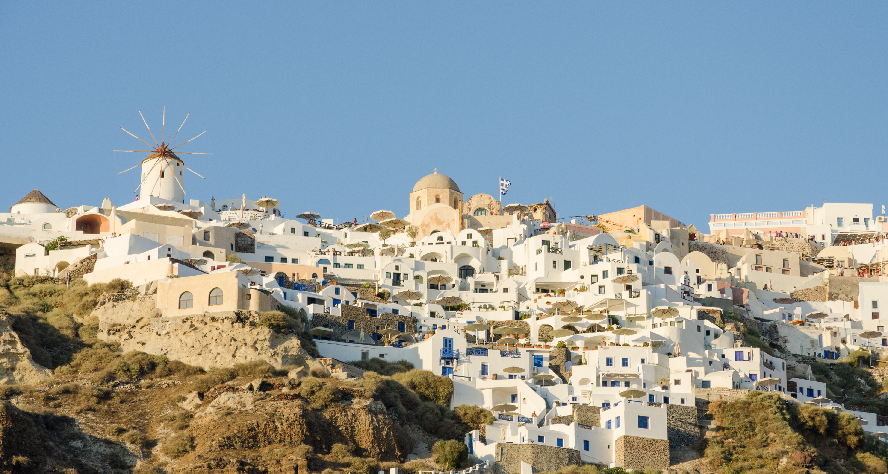

# 그리스 여행 ✈️

> 작성자: 박주영

---

## 🌍 나라 소개 · Intro

그리스(Greece)는 **유럽 남동부 발칸반도 남쪽**에 위치한 나라로, 에게해와 이오니아해를 따라 수많은 섬이 펼쳐져 있습니다. 수도는 **아테네(Athens)**이며, 고대 유적과 푸른 바다를 함께 만날 수 있는 곳입니다.

### 📋 한눈에 보는 그리스

| 항목 | 내용 |
| :--- | :--- |
| 정식 명칭 | 그리스 공화국(Hellenic Republic) |
| 수도 | 아테네(Athens) |
| 위치 | 유럽 남동부, 발칸반도 남단 |
| 공용어 | 그리스어 |
| 통화 | 유로(€) |
| 자연환경 | 산지가 많은 본토와 에게해·이오니아해의 여러 섬 |

### 🏛️ 고대 문명이 남긴 발자취

그리스는 **서양 철학과 민주주의의 발전에 큰 영향을 준 나라**입니다. 고대 아테네에서는 시민들이 정치에 참여하는 민주정이 발달했고, 소크라테스·플라톤·아리스토텔레스 같은 철학자들이 활동했습니다. 또한 고대 올림픽이 시작된 **올림피아**도 그리스에 있습니다.

제우스, 아테나, 포세이돈 등이 등장하는 *그리스 신화*는 신전과 유적을 이해하는 재미를 더해 줍니다. 아테네의 아크로폴리스와 파르테논 신전은 이러한 역사와 문화를 보여 주는 대표적인 유적입니다.

### 🌊 바다와 섬이 만드는 풍경

그리스는 대체로 **여름이 덥고 건조하며 겨울이 온화하고 비가 오는 지중해성 기후**를 보입니다. 다만 산악 지역과 섬은 위치와 고도에 따라 날씨가 다릅니다. 산토리니의 하얀 건물과 푸른 돔, 크레타의 해변, 본토의 산악 풍경처럼 지역마다 서로 다른 매력을 지니고 있습니다.

그리스의 매력은 다음과 같이 정리할 수 있습니다.

- **역사:** 고대 신전과 유적을 통해 만나는 오랜 문명
- **자연:** 지중해의 푸른 바다와 개성 있는 섬 풍경
- **식문화:** 올리브유, 채소, 치즈 등을 활용하는 지중해식 음식
- **문화:** 신화와 철학, 올림픽으로 이어지는 풍부한 이야기

> **그리스는 고대 문명의 흔적과 지중해의 아름다운 자연을 함께 경험할 수 있는 나라입니다.**

### 📷 사진으로 보는 그리스

*산토리니는 하얀 건물과 푸른 바다가 어우러지는 풍경으로 잘 알려진 그리스의 섬입니다.*

## 📍 유명 여행지

### 🏛️ 1. 아테네 아크로폴리스

**아크로폴리스**는 아테네의 언덕 위에 자리한 고대 유적지입니다. 대표 건축물인 **파르테논 신전**을 통해 고대 그리스의 건축미를 살펴볼 수 있습니다.

- **볼거리:** 파르테논 신전과 언덕에서 내려다보는 아테네 전경
- **사진:** [C.Skaug / Wikimedia Commons](https://commons.wikimedia.org/wiki/File:Parthenon-akropolis-athen.jpg), [CC BY-SA 4.0](https://creativecommons.org/licenses/by-sa/4.0/) · 원본 사용

### 🌅 2. 산토리니 이아 마을

**이아(Oia)**는 산토리니의 절벽을 따라 하얀 건물들이 모여 있는 마을입니다. 바다를 바라보며 골목을 걷고, 해 질 무렵에는 아름다운 노을을 감상할 수 있습니다.

- **볼거리:** 절벽 위 마을 풍경과 에게해의 일몰
- **사진:** [Norbert Nagel / Wikimedia Commons](https://commons.wikimedia.org/wiki/File:Oia_-_Santorini_-_Greece_-_11.jpg), [CC BY-SA 3.0](https://creativecommons.org/licenses/by-sa/3.0/) · 원본 사용

## 🍽️ 유명 음식

<!-- 음식 소개와 이미지를 넣으세요. -->

## ✨ 자유 주제

<!-- 원하는 주제를 정하고 단락을 작성하세요. -->

## 🧳 마무리 및 본인이 추천하는 코스

<!-- 마무리 글과 추천 여행 코스를 작성하세요. -->

---
## 출처 모음
[산토리니 사진](https://www.joongang.co.kr/article/23716459)

[← 전체 여행지 보기](../README.md)
