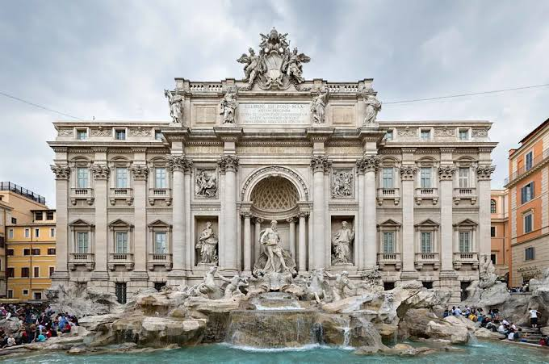
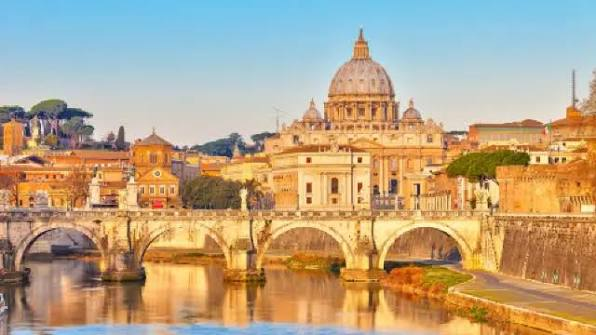
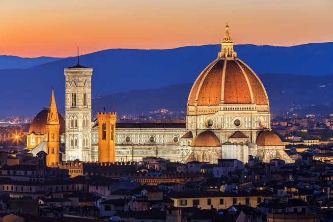
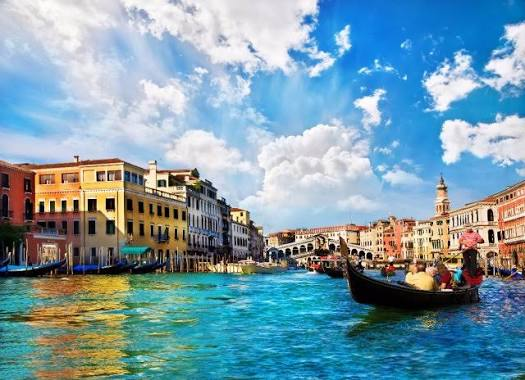

# 이탈리아 여행 ✈️

> 작성자: 이상민

---

## 🌍 나라 소개 · Intro
이탈리아는 지중해를 향해 장화 모양으로 길게 뻗은 남유럽의 나라입니다.  
수도는 로마이며, 북쪽의 알프스 산맥부터 남쪽의 시칠리아 섬까지 지역마다 기후와 풍경, 음식 문화가 크게 다릅니다.

고대 로마 제국의 중심지였고, 중세 이후에는 피렌체를 중심으로 르네상스가 꽃피면서 레오나르도 다 빈치, 미켈란젤로, 라파엘로 같은 예술가들이 활동했습니다.   
오랫동안 여러 도시국가로 나뉘어 있다가 1861년에 하나의 나라로 통일되었는데, 그래서 지금도 도시마다 사투리와 요리, 분위기가 뚜렷하게 다릅니다.

이탈리아는 세계에서 유네스코 세계유산을 가장 많이 보유한 나라 중 하나로, 도시 전체가 박물관이라는 말을 들을 정도입니다.
역사와 예술, 그리고 음식까지 한 번에 즐길 수 있다는 점이 제가 이탈리아를 가고 싶은 여행지로 고른 이유입니다.

<!-- 나라 소개를 작성하세요. -->

## 📍 유명 여행지
### 🏛️ 로마 (Roma)

**콜로세움**은 서기 80년경 완공된 고대 로마의 원형 경기장으로, 약 5만 명의 관중이 검투사 경기를 관람했던 곳입니다. 2000년 가까이 지난 지금도 거대한 규모가 그대로 남아 있어 로마를 대표하는 상징이 되었습니다.  

**트레비 분수**는 바로크 양식의 화려한 분수로, 분수를 등지고 동전을 던지면 다시 로마에 돌아올 수 있다는 이야기로 유명합니다.

로마 시내 안에는 세계에서 가장 작은 나라인 **바티칸 시국**도 있습니다. 
성 베드로 대성당과 미켈란젤로의 천장화가 있는 시스티나 성당은 로마 여행에서 꼭 들러야 할 곳입니다.

### 🎨 피렌체 (Firenze)

피렌체는 르네상스가 시작된 도시입니다. 도시의 중심인 **두오모(산타 마리아 델 피오레 대성당)** 는 브루넬레스키가 설계한 거대한 붉은 돔으로 유명하며, 463개의 계단을 올라 꼭대기에 서면 주황빛 지붕이 가득한 피렌체 시내가 한눈에 내려다보입니다.

**우피치 미술관**에서는 보티첼리의 「비너스의 탄생」 같은 르네상스 명작을 볼 수 있고, 아르노 강 위의 **베키오 다리**에는 오래된 금은방들이 줄지어 있습니다. 해 질 무렵 **미켈란젤로 광장**에 올라가서 보는 노을은 피렌체 여행의 하이라이트입니다.

### 🚤 베네치아 (Venezia)

베네치아는 100개가 넘는 작은 섬들이 운하와 다리로 이어진 '물의 도시'입니다. 자동차 대신 수상버스(바포레토)와 곤돌라가 교통수단 역할을 합니다.
**산마르코 광장**과 **리알토 다리**가 대표 명소이고, 근처의 **부라노 섬**은 알록달록한 집들로, **무라노 섬**은 유리 공예로 유명합니다.

### 🌊 아말피 해안 (Costiera Amalfitana)

남부의 아말피 해안은 절벽을 따라 파스텔톤 마을들이 이어진 해안 도로로, 그중 **포지타노**는 엽서 속 풍경 같은 마을로 손꼽힙니다. 레몬이 특산물이라 레몬 술인 리몬첼로도 맛볼 수 있습니다.
<!-- 여행지 소개와 이미지를 넣으세요. -->

## 🍽️ 유명 음식

피자
<!-- 음식 소개와 이미지를 넣으세요. -->

## ✨ 자유 주제

<!-- 원하는 주제를 정하고 단락을 작성하세요. -->

## 🧳 마무리 및 본인이 추천하는 코스

<!-- 마무리 글과 추천 여행 코스를 작성하세요. -->

---

[← 전체 여행지 보기](../README.md)
