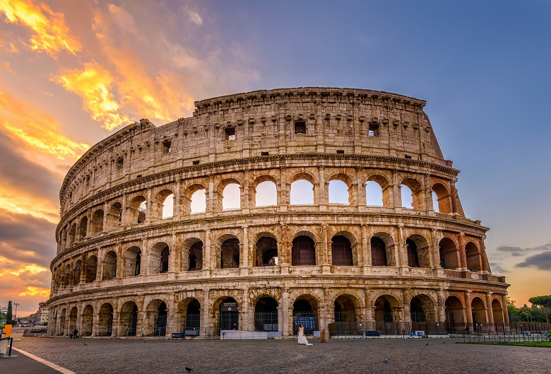

# 이탈리아 여행 ✈️

> 작성자: 이상민

---

## 🌍 나라 소개 · Intro
이탈리아는 도시마다 뚜렷한 개성과 독특한 역사적 배경을 가지고 있어 여행자들에게 큰 사랑을 받는 나라입니다.

<!-- 나라 소개를 작성하세요. -->

## 📍 유명 여행지

콜로세움
<!-- 여행지 소개와 이미지를 넣으세요. -->

## 🍽️ 유명 음식

피자
<!-- 음식 소개와 이미지를 넣으세요. -->

## ✨ 자유 주제

<!-- 원하는 주제를 정하고 단락을 작성하세요. -->

## 🧳 마무리 및 본인이 추천하는 코스

<!-- 마무리 글과 추천 여행 코스를 작성하세요. -->

---

[← 전체 여행지 보기](../README.md)
