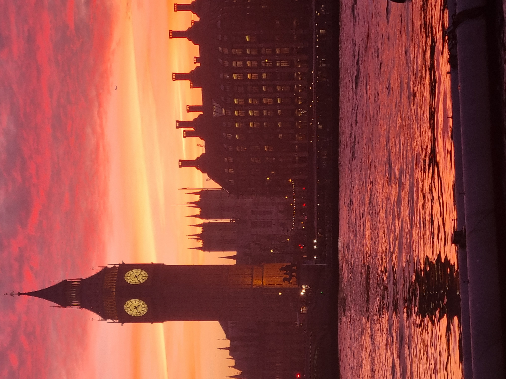

# 영국 여행 ✈️

> 작성자: 이원기

---

## 🌍 나라 소개 · Intro

<!-- 나라 소개를 작성하세요. -->

**영국(United Kingdom)**은 찬란한 역사와 수백 년의 전통, 그리고 현대 문화가 완벽하게 조화를 이루는 매력적인 나라입니다. 흔히 '신사의 나라'로 불리는 영국은 고풍스러운 클래식함과 현대적인 다채로움이 공존하는 독특한 문화적 매력을 지니고 있습니다.

붉은색 이층 버스와 공중전화 부스가 정겨운 풍경을 더해주는 세계적인 대도시 **런던**을 비롯해, 화려한 왕실의 전통을 간직한 **버킹엄 궁전**, 그리고 내셔널 갤러리와 테이트 모던 등 세계적인 명화와 현대 미술을 품은 미술관들까지 볼거리가 가득합니다.

셰익스피어와 비틀스, 해리 포터의 고향이자 고전적인 고딕 건축물과 아름다운 자연 풍경이 공존하는 영국으로 여러분을 초대합니다.

## 📍 유명 여행지

<!-- 여행지 소개와 이미지를 넣으세요. -->

## 🍽️ 유명 음식

<!-- 음식 소개와 이미지를 넣으세요. -->

## ✨ 자유 주제

<!-- 원하는 주제를 정하고 단락을 작성하세요. -->

## 🧳 마무리 및 본인이 추천하는 코스

<!-- 마무리 글과 추천 여행 코스를 작성하세요. -->

---

[← 전체 여행지 보기](../README.md)
