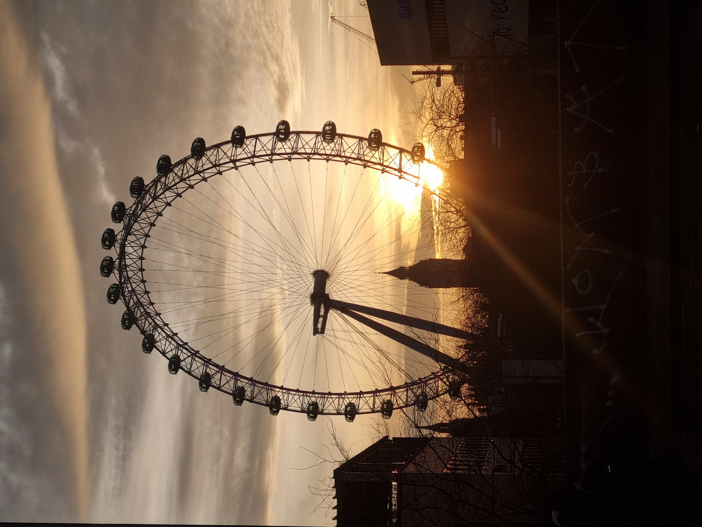
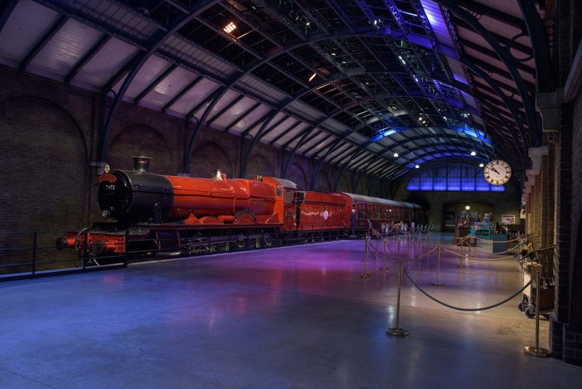
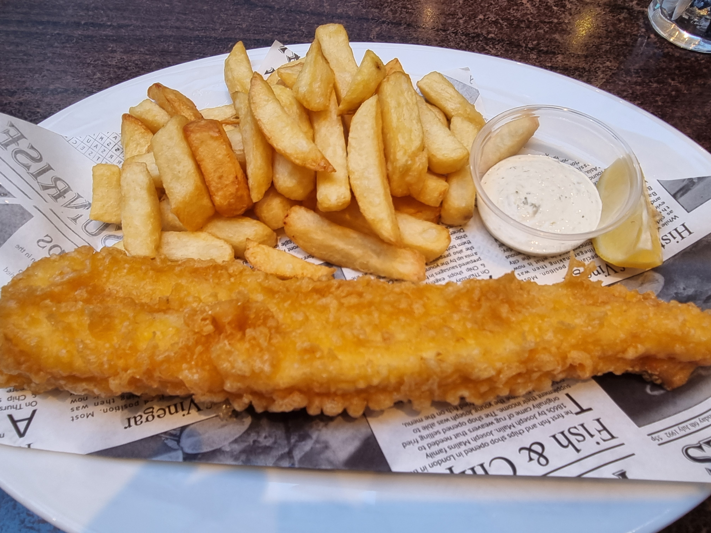
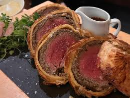
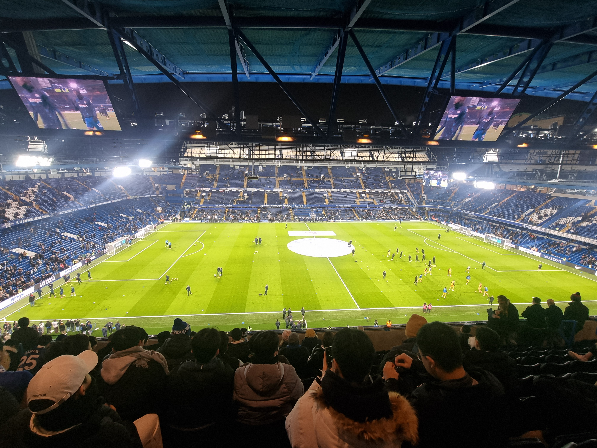
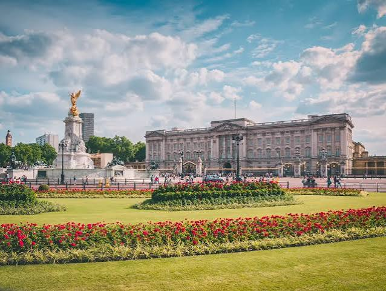

# 영국 여행 ✈️

> 작성자: 이원기

---

## 🌍 나라 소개 · Intro

<!-- 나라 소개를 작성하세요. -->

**영국**(United Kingdom)은 찬란한 역사와 수백 년의 전통, 그리고 현대 문화가 완벽하게 조화를 이루는 매력적인 나라입니다. 흔히 '신사의 나라'로 불리는 영국은 고풍스러운 클래식함과 현대적인 다채로움이 공존하는 독특한 문화적 매력을 지니고 있습니다.

붉은색 이층 버스와 공중전화 부스가 정겨운 풍경을 더해주는 세계적인 대도시 **런던**을 비롯해, 화려한 왕실의 전통을 간직한 **버킹엄 궁전**, 그리고 내셔널 갤러리와 테이트 모던 등 세계적인 명화와 현대 미술을 품은 미술관들까지 볼거리가 가득합니다.

셰익스피어와 비틀스, 해리 포터의 고향이자 고전적인 고딕 건축물과 아름다운 자연 풍경이 공존하는 영국으로 여러분을 초대합니다.

## 📍 유명 여행지

<!-- 여행지 소개와 이미지를 넣으세요. -->

### 🎡 런던의 풍경을 한눈에, 런던 아이 (The London Eye)
템스강 변에 위치한 대형 관람차로, 현대 런던을 상징하는 대표적인 랜드마크입니다. 캡슐에 탑승해 높이 오르면 빅벤과 국회의사당은 물론 런던 시내 전체를 360도 파노라마 뷰로 한눈에 담을 수 있습니다. 특히 해 질 녘 노을과 함께 펼쳐지는 런던의 야경은 매혹적인 분위기를 선사합니다.

### 🧙‍♂️ 마법 세계로의 특별한 여정, 해리포터 스튜디오 (Warner Bros. Studio Tour London)
세계적인 사랑을 받은 영화 <해리포터> 시리즈의 제작 현장을 그대로 옮겨 놓은 체험형 전시관입니다. 호그와트 마법학교의 대연회장, 9와 4/3 승강장, 다이애건 앨리 등 실제 촬영 세트장과 의상, 소품들을 눈앞에서 직접 확인하며 영화 속 마법 세계로 들어간 듯한 몰입감을 선사합니다.

> 📷 이미지 출처: [하나투어](https://fnd.hanatour.com/product-detail/LON/MHJ-PRD2E83BCBE9/)

## 🍽️ 유명 음식

<!-- 음식 소개와 이미지를 넣으세요. -->

### 🐟 영국의 대표 영혼의 음식, 피쉬 앤 칩스 (Fish and Chips)
겉은 바삭하고 속은 촉촉하게 튀겨낸 두툼한 생선구이(대구 또는 가자미)에 고소한 감자튀김을 곁들여 먹는 영국의 대표적인 국민 음식입니다. 새콤한 식초(Malt Vinegar)와 타르타르소스, 고소한 완두콩 매시(Mushed Peas)를 함께 곁들여 먹으면 더욱 풍부한 풍미를 즐길 수 있습니다.

### 🥩 고급스러운 왕실의 풍미, 비프 웰링턴 (Beef Wellington)
소고기 안심에 버섯 다진 것(떡셀)과 하몽 또는 파르마 하몽을 감싼 뒤, 바삭한 페이스트리 반죽을 덮어 오븐에 구워낸 영국 전통의 고급 요리입니다. 바삭한 페이스트리의 식감과 육즙 가득한 안심의 부드러움이 완벽한 조화를 이루어 영국의 특별한 식문화를 경험해보기 좋은 메뉴입니다.

> 📷 이미지 출처: [인스타그램](https://www.instagram.com/p/DA47kDrI4Zc/?img_index=1/)

## ✨ 자유 주제

<!-- 원하는 주제를 정하고 단락을 작성하세요. -->

### ⚽ 축구의 종주국, 영국의 축구 문화
영국은 현대 축구의 규칙이 처음으로 확립된 **축구의 종주국**이자, 세계에서 가장 인기가 높은 세계 최고 수준의 프로 축구 리그인 **프리미어리그**(EPL)의 고향입니다. 영국인들에게 축구는 단순한 스포츠를 넘어 주말마다 온 가족과 지역 사회가 하나 되어 목소리를 높이는 삶이자 중요한 문화 그 자체입니다. 도시 곳곳마다 고유의 역사와 전통을 자랑하는 구단들이 자리 잡고 있어, 어디서든 뜨거운 축구 열기를 온몸으로 느낄 수 있습니다.

### 🔵 런던을 대표하는 명문 클럽, 첼시 FC (Chelsea FC)
프리미어 리그의 많은 팀중 하나를 소개하려 합니다. 런던 서부에 위치한 스탬퍼드 브리지(Stamford Bridge)를 홈구장으로 사용하는 첼시는 세계적인 인지도를 자랑하는 영국의 대표 명문 구단 중 하나입니다. 푸른색 유니폼이 상징이어서 '더 블루스(The Blues)'라는 별칭으로도 불리며, UEFA 챔피언스리그와 프리미어리그 등 수많은 우승 트로피를 들어 올린 화려한 역사를 가지고 있습니다. 이번 시즌 새로 부임한 사비 알론소 감독과 막강한 공격력을 보여주고 있는 일명 CPR 라인은 경기를 보는 사람들에게 큰 즐거움을 주고 있습니다. 영국 축구에 관심을 갖고자 한다면 런던의 자존심 첼시의 경기를 한번 즐겨보는 것을 추천합니다.

## 🧳 마무리 및 본인이 추천하는 코스

<!-- 마무리 글과 추천 여행 코스를 작성하세요. -->

### 🗺️ 런던 도보 여행 추천 코스 (Day Course)

> **📍 추천 동선:**  
> **노팅힐** ➡️ **하이드 파크** ➡️ **버킹엄 궁전** ➡️ **웨스트민스터 사원** ➡️ **빅벤 (웨스트민스터 교)** ➡️ **런던 아이**

런던의 클래식한 분위기와 감성, 그리고 환상적인 노을을 하루 만에 알차게 즐길 수 있는 대표 도보 여행 코스입니다.

* **🎬 1. 노팅힐 (Notting Hill)**  
  영화 <노팅힐>의 배경으로 유명한 파스텔톤 건물의 아름다운 거리입니다. 포토벨로 마켓을 거닐며 빈티지 소품을 구경하고 감성 가득한 사진을 남기며 여행을 시작하세요.
* **🌳 2. 하이드 파크 (Hyde Park)**  
  도심 속 거대한 푸른 휴식처입니다. 탁 트인 서펜타인 호수를 따라 유유자적 산책하며 런던 현지인들의 여유로운 일상을 느껴볼 수 있습니다.
* **👑 3. 버킹엄 궁전 (Buckingham Palace)**  
  영국 왕실의 정수를 보여주는 궁전으로, 시간에 맞추어 방문하면 화려하고 웅장한 근위병 교대식을 직접 관람할 수 있습니다.
* **🏛️ 4. 웨스트민스터 사원 (Westminster Abbey)**  
  영국 왕실의 대관식과 역사가 숨 쉬는 고딕 양식의 대성당입니다. 세월의 깊이가 느껴지는 웅장한 외관을 둘러보며 영국의 전통을 체감해 보세요.
* **🌆 5. 빅벤 & 웨스트민스터 교 (Big Ben & Westminster Bridge)**  
  해 질 녘이 가까워지면 웨스트민스터 다리로 이동합니다. 다리 위에서 바라보는 붉은 노을빛을 받아 황금색으로 물드는 빅벤의 웅장한 실루엣은 런던 여행 중 절대 놓쳐서는 안 될 감동적인 장면을 연출합니다.
* **🎡 6. 런던 아이 (The London Eye)**  
  여행의 완벽한 마무리 코스입니다. 템스강 너머로 해가 저물어가는 노을녘부터 화려하게 불빛이 들어오는 런던의 야경까지, 대형 관람차 안에서 360도로 펼쳐지는 로맨틱한 파노라마 뷰를 감상해 보세요.
  

---

[← 전체 여행지 보기](../README.md)
