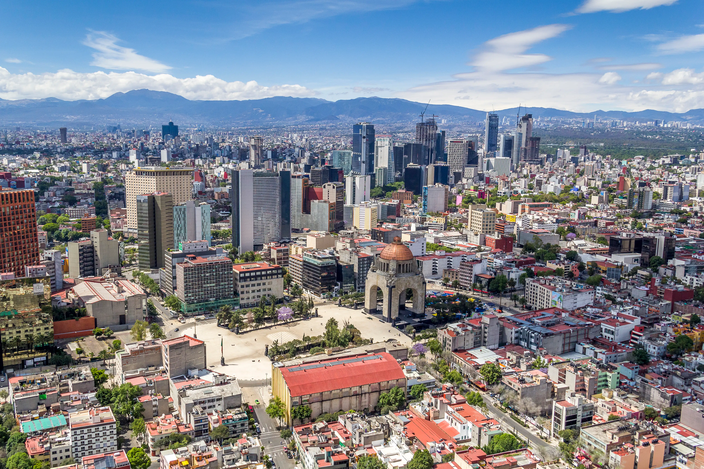
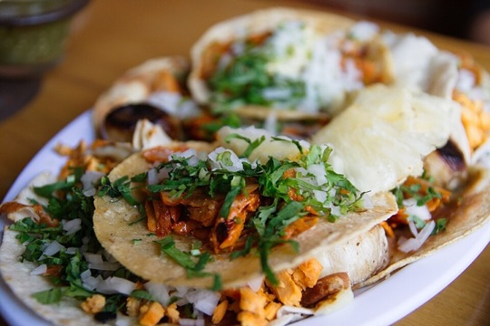
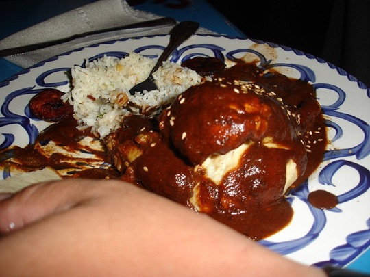

# 멕시코 여행 ✈️

> 작성자: 이윤호

---

## 🌍 나라 소개 · Intro

> **고대 문명의 유적부터 활기찬 도시의 시장까지, 멕시코에서는 서로 다른 시대와 지역의 풍경을 만날 수 있습니다.**

멕시코는 북아메리카 남부에 자리한 나라로 태평양, 멕시코만, 카리브해와 맞닿아 있습니다. 정식 국명은 **멕시코 합중국**이며, 수도 멕시코시티와 31개 주로 이루어진 연방 국가입니다. 산맥과 고원, 사막, 열대우림, 해안이 이어지는 넓은 땅에서 지역마다 다른 자연환경과 문화를 만날 수 있습니다.

올멕과 마야를 비롯한 메소아메리카 문명의 유산, 스페인 식민 시대의 건축, 오늘날의 도시 문화가 한 나라 안에 겹쳐 있습니다. 멕시코 여행은 한 가지 모습만 보는 일이 아니라 **지역마다 달라지는 역사와 생활을 따라가는 여정**입니다.

## 📍 유명 여행지

처음 여행지를 고를 때는 아래 표에서 지역과 관심사를 먼저 살펴보세요. 멕시코시티와 테오티우아칸은 한 여행에 묶기 쉽고, 오악사카와 유카탄반도는 각각 별도의 이동 일정을 두면 좋습니다.

| 지역 | 추천 장소 | 여행의 중심 |
|---|---|---|
| 멕시코시티 | 역사 지구, 소치밀코 | 도시의 역사와 운하 풍경 |
| 멕시코시티 근교 | 테오티우아칸 | 메소아메리카 고대 도시와 피라미드 |
| 유카탄반도 | 치첸이트사 | 마야 문명의 건축 유적 |
| 오악사카 | 오악사카 구시가지, 몬테알반 | 식민 도시와 사포텍 유적 |

### 1. 멕시코시티 역사 지구와 소치밀코

아즈텍의 옛 수도 테노치티틀란 위에 세워진 멕시코시티에서는 고대 유적과 식민 시대 건축, 현대의 대도시 풍경이 만납니다. 소칼로 광장과 대성당, 템플로 마요르 주변을 걷고 박물관을 둘러보면 도시의 여러 시대를 차례로 살펴볼 수 있습니다.

도심에서 남쪽으로 이동하면 **소치밀코의 운하와 인공 섬 치남파**가 이어집니다. 운하를 따라 배를 타면 오늘날의 대도시와 멕시코 계곡의 옛 수상 경관을 함께 떠올릴 수 있습니다. 두 지역은 [UNESCO 세계유산 구역](https://whc.unesco.org/en/list/412/)에 함께 포함되어 있습니다.

### 2. 테오티우아칸

멕시코시티에서 당일 여행으로 다녀올 수 있는 고대 도시입니다. 넓은 유적지에는 **태양의 피라미드와 달의 피라미드**, 사자의 거리, 케찰코아틀 신전이 있습니다. [INAH 안내](https://lugares.inah.gob.mx/es/fut-cultura/6731)에 따르면 유적지에는 기념비적인 건축물과 주거 구역, 벽화가 남아 있어 당시 도시의 규모와 생활을 상상해 볼 수 있습니다. 야외에서 걷는 시간이 길기 때문에 모자와 물을 챙기세요.

### 3. 치첸이트사

유카탄반도의 마야 문명을 대표하는 유적입니다. 쿠쿨칸 신전으로도 불리는 **엘 카스티요**, 전사의 신전과 구기장 등을 둘러볼 수 있습니다. [INAH 소개](https://lugares.inah.gob.mx/en/node/4335)는 이 도시가 마야 지역의 건축과 중앙 멕시코의 영향을 함께 보여준다고 설명합니다. 멕시코시티에서 거리가 있으므로 칸쿤이나 메리다를 여행할 때 묶어 방문하는 편이 좋습니다.

### 4. 오악사카와 몬테알반

오악사카 구시가지는 광장과 시장, 낮은 건물 사이를 걸으며 지역의 일상을 느끼기 좋은 도시입니다. 가까운 몬테알반은 산 위에 조성된 사포텍 문명의 중심지로, 넓은 중앙 광장과 피라미드, 계곡 전망이 특징입니다. [UNESCO 세계유산 설명](https://whc.unesco.org/en/list/415/)은 오악사카의 역사 지구와 몬테알반을 서로 다른 시대와 문화가 이어지는 한 유산으로 소개합니다.

## 🍽️ 유명 음식

멕시코 음식은 **옥수수·콩·고추**를 비롯한 재료와 농사, 조리 기술, 공동체의 전통이 이어져 만들어집니다. UNESCO는 전통 멕시코 요리를 재배부터 조리와 식사까지 이어지는 문화적 실천으로 소개합니다. 대표 음식 세 가지를 골라봤습니다.

- **타코 알 파스토르:** 양념한 돼지고기를 세로 꼬치에 구워 얇게 썰고, 작은 옥수수 토르티야에 올려 먹습니다. 양파와 고수, 살사, 파인애플을 곁들여 보세요. 멕시코시티의 타케리아에서 여러 살사를 조금씩 맛보며 나만의 조합을 찾는 재미가 있습니다.

- **몰레 포블라노:** 푸에블라를 대표하는 음식입니다. 여러 고추와 향신료, 견과류 등을 갈아 만든 진한 소스인 몰레를 닭고기 등에 곁들입니다. 조리법은 지역과 가정에 따라 달라 한 가지 맛으로 설명하기 어렵습니다.

- **타말:** 옥수수 반죽에 고기나 채소, 소스를 넣고 옥수수 껍질이나 바나나 잎으로 감싸 쪄 냅니다. 지역마다 속재료와 모양이 달라 시장에서 여러 종류를 만날 수 있습니다. 따뜻한 아톨레와 곁들이면 든든한 한 끼가 됩니다.

## ✨ 자유 주제

## 🧳 마무리 및 본인이 추천하는 코스

---

[← 전체 여행지 보기](../README.md)

---
## Reference Source

- [About Mexico — Visit Mexico](https://visitmexico.com/en/pagina/sobre-mexico)
- [Archaeological Sites — National Institute of Anthropology and History (INAH)](https://lugares.inah.gob.mx/en/zonas-arqueologicas)
