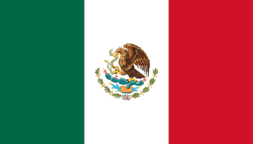
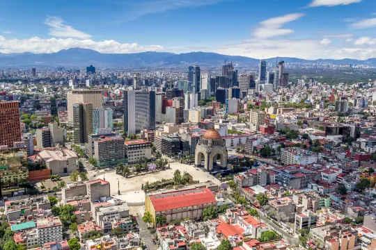

# 멕시코 여행 ✈️

> 작성자: 이윤호

---

## 🌍 나라 소개 · Intro

멕시코는 북아메리카 남부에 자리한 나라로, 태평양과 멕시코만, 카리브해에 걸쳐 있습니다. 정식 국명은 멕시코 합중국이며, 31개 주와 수도인 멕시코시티로 이루어진 연방 국가입니다.

넓은 국토에는 높은 산맥과 고원, 사막, 열대우림과 해안 지대가 함께 있어 지역마다 자연환경과 기후가 다채롭습니다. 올멕과 마야를 비롯한 여러 메소아메리카 문명의 유산에 스페인 식민 시대 이후의 문화가 더해져, 오늘날 멕시코의 건축과 예술, 축제, 음식에 다양한 흔적을 남겼습니다. 멕시코는 풍부한 역사와 자연, 지역마다 다른 문화를 함께 만날 수 있는 나라입니다.

## 📍 유명 여행지

## 🍽️ 유명 음식

## ✨ 자유 주제

## 🧳 마무리 및 본인이 추천하는 코스

---

[← 전체 여행지 보기](../README.md)

---
## Reference Source

- [About Mexico — Visit Mexico](https://visitmexico.com/en/pagina/sobre-mexico)
- [Archaeological Sites — National Institute of Anthropology and History (INAH)](https://lugares.inah.gob.mx/en/zonas-arqueologicas)
