# 일본 여행 ✈️

> 작성자: 정현호

---

## 🌍 나라 소개 · Intro

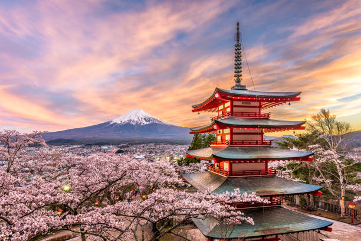

# 🌸 전통과 현대가 공존하는 일본으로 떠나자! 🌸

## 🇯🇵 일본, 어떤 곳일까요?

비행기로 단 2시간 남짓이면 닿을 수 있는 일본은, 발을 내딛는 순간 전혀 다른 세상이 펼쳐지는 매혹적인 나라입니다. 

**1. 과거와 미래가 교차하는 시공간**
전통과 현대가 가장 완벽하게 공존하는 일본에서는 최첨단 빌딩 숲 사이로 수백 년 된 고즈넉한 신사와 사찰이 숨 쉬고 있습니다. 트렌드의 중심지 '도쿄'의 화려한 네온사인과 천년 고도 '교토'의 고풍스러운 목조건물 골목길은 각기 다른 시대에 머무는 듯한 신비로운 경험을 선사합니다.

**2. 365일 언제나 새로운, 사계절의 향연**
일본은 계절의 변화가 뚜렷하여 언제 방문해도 색다른 아름다움을 만날 수 있습니다. 
* 🌸 **봄:** 온 세상을 연분홍빛으로 물들이는 흩날리는 벚꽃
* 🎆 **여름:** 활기찬 마츠리(전통 축제)와 청량한 푸른 자연
* 🍁 **가을:** 발길 닿는 곳마다 그림이 되는 화려한 단풍
* ❄️ **겨울:** 새하얀 설경 속에서 즐기는 따뜻한 힐링 온천욕

**3. 미식가들의 멈출 수 없는 천국**
신선함이 살아있는 스시와 사시미, 장인 정신이 깃든 진한 국물의 라멘, 입안에서 눈처럼 녹아내리는 와규, 그리고 시각과 미각을 동시에 사로잡는 정갈한 가이세키 정식까지. 거리 곳곳에 숨겨진 소박한 이자카야부터 미슐랭 레스토랑까지, 일본은 여행의 기쁨을 배가시켜 줄 맛있는 즐거움으로 가득합니다.

**4. 안전하고 편안한 여행**
세계 최고 수준의 치안과 깨끗한 거리, 거미줄처럼 촘촘하고 편리한 대중교통망은 남녀노소 누구나 여행하기 좋은 환경을 제공합니다. 특히 일본 특유의 진심 어린 환대 문화인 '오모테나시'는 여행 내내 여러분을 가장 귀한 손님으로 만들어 드릴 것입니다.

## 📍 유명 여행지
# 일본, 어디부터 가볼까?

일본은 가까워서 부담 없이 떠나기 좋고, 갈 때마다 다른 얼굴을 보여주는 나라예요. 많은 분들이 가장 먼저 찾는 곳들을 편하게 정리해 봤어요.

## 도쿄 – 옛 정취와 최신 유행이 한 도시에
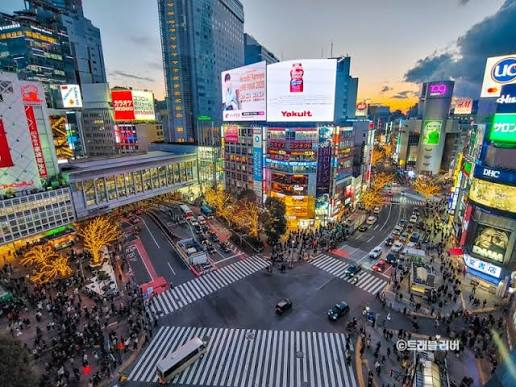  

처음 일본을 간다면 도쿄가 무난해요. 아사쿠사 센소지에서 전통 분위기를 느끼고, 시부야 스크램블 교차로에서 북적이는 도시의 에너지를 마주하다 보면 하루가 금방 가요. 쇼핑과 먹거리도 워낙 다양해서 어디를 가도 심심할 틈이 없답니다.

## 오사카 – 먹는 즐거움이 가득한 곳
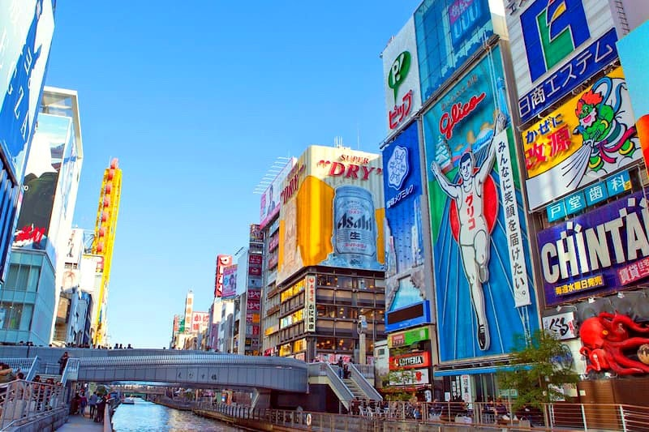  

오사카는 한마디로 "맛있는 도시"예요. 도톤보리 거리를 걸으며 타코야키와 오코노미야키를 하나씩 맛보는 재미가 쏠쏠하고, 사람들도 유쾌해서 여행 분위기가 한결 편안해져요. 유니버설 스튜디오나 오사카성도 빼놓기 아쉽고, 교토나 나라까지 당일로 다녀오기에도 좋아요.

## 교토 – 천천히 걷고 싶은 옛 도읍
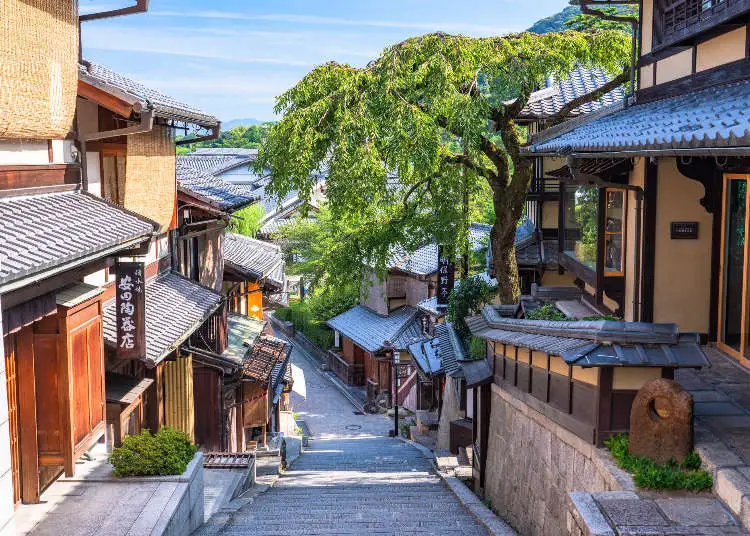

교토는 서두르지 않고 걸을 때 가장 매력적이에요. 붉은 도리이가 끝없이 이어지는 후시미 이나리, 고즈넉한 기요미즈데라, 바람 소리가 좋은 아라시야마 대나무숲까지 사진 찍기 좋은 장면이 가득해요. 벚꽃이 피는 봄이나 단풍이 드는 가을엔 특히 아름답지만 사람이 많으니, 이른 아침에 움직이는 걸 추천해요.

## 홋카이도 – 자연과 맛을 함께
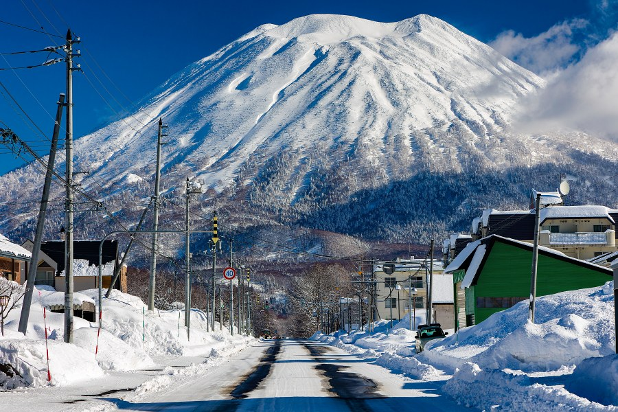
넓은 땅만큼 풍경도 시원시원해요. 겨울엔 삿포로 눈축제와 스키, 여름엔 후라노의 라벤더밭이 대표적이에요. 오타루의 운하 마을에서 신선한 해산물을 먹고 온천에 몸을 담그면 여행의 피로가 싹 풀려요. 이동 거리가 길어서 렌터카를 많이 이용해요.

## 언제 가면 좋을까요?
- **봄 (3~4월)**: 벚꽃이 한창이에요.
- **여름 (7~8월)**: 마쓰리(축제)와 시원한 홋카이도, 바다가 있는 오키나와가 잘 어울려요.
- **가을 (10~11월)**: 단풍 구경하기 가장 좋아요.
- **겨울 (12~2월)**: 온천과 눈 풍경이 빛나는 계절이에요.

취향에 맞는 도시 한두 곳을 골라 여유 있게 다녀오는 게 가장 좋은 일본 여행법이에요. 😊

## 🍽️ 유명 음식

🍱 일본 여행 필수 맛보기! 대표 유명 음식 3선

일본은 시각과 미각을 모두 만족시키는 섬세하고 다채로운 미식 문화를 자랑합니다. 일본 여행 시 반드시 맛보아야 할 대표적인 음식 3가지를 소개합니다.

## 1.스시 (Sushi) 🍣 ## 
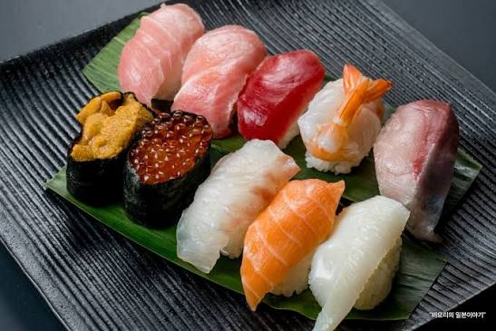  

식재료 본연의 맛을 살린 일본 미식의 정수

신선한 생선이나 해산물을 식초, 소금, 설탕으로 간을 한 밥(샤리) 위에 얹어 먹는 일본의 가장 대표적인 요리입니다.

특징 및 매력:

장인의 섬세한 손길로 쥐어내는 고급 스시 오마카세부터, 가성비 좋게 다양한 접시를 즐길 수 있는 회전 초밥까지 선택의 폭이 매우 넓습니다.

참치, 연어, 새우, 성게알 등 계절에 따라 가장 맛있는 제철 해산물의 신선함을 입안 가득 느낄 수 있습니다.

 ## 2.라멘 (Ramen) 🍜 ##
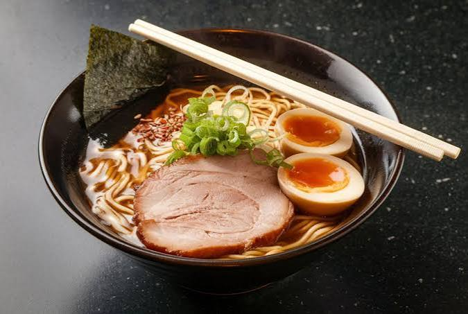  

깊고 진한 육수와 쫄깃한 면발의 완벽한 조화

오랜 시간 끓여낸 진한 육수에 면을 삶아 넣고, 돼지고기 구이(차슈), 반숙 계란(아지타마고), 파, 김 등 다양한 고명을 얹어 먹는 대중적인 면 요리입니다.

특징 및 매력:

돈코츠(돼지뼈): 진하고 뽀얀 국물로 후쿠오카 지역에서 유명합니다.

쇼유(간장) & 시오(소금): 맑고 깔끔한 감칠맛이 특징으로 도쿄 등에서 즐겨 먹습니다.

미소(된장): 구수하고 깊은 맛을 내며 홋카이도 삿포로 지역의 명물입니다.

지역과 가게마다 고유의 비법 육수를 가지고 있어 '라멘 투어'를 즐기기에도 좋습니다.

## 3.오코노미야키 (Okonomiyaki) 🥞 ##
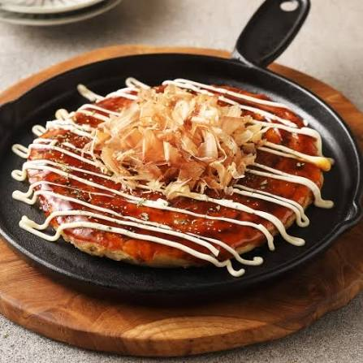  

눈앞에서 구워지는 소리와 냄새가 일품인 철판 요리

밀가루 반죽에 잘게 썬 양배추와 고기, 해산물 등 '자신이 좋아하는 것(오코노미)'을 듬뿍 넣고 철판 위에서 구워(야키) 먹는 일본식 부침개입니다.

특징 및 매력:

다 구워진 후 달콤짭짤한 특제 소스와 마요네즈, 가쓰오부시(가다랑어포)를 듬뿍 올려 먹으면 환상적인 단짠의 맛을 느낄 수 있습니다.

오사카식: 모든 재료를 한데 섞어서 두툼하게 부쳐냅니다.

히로시마식: 얇은 반죽 위에 재료를 층층이 쌓고, 야키소바(볶음면)를 더해 구워내는 것이 특징입니다.

## 🏮 일본의 열정과 전통이 살아 숨 쉬는 대표 축제 (마츠리)

일본의 축제인 '마츠리'는 각 지역의 역사와 전통, 그리고 사람들의 활기를 가장 가까이서 느낄 수 있는 특별한 이벤트입니다. 일본 여행 중 시기가 맞는다면 꼭 한번 경험해 봐야 할 대표적인 명물 축제 4곳을 소개합니다.

### 1. 삿포로 눈 축제 (Sapporo Snow Festival) ⛄  
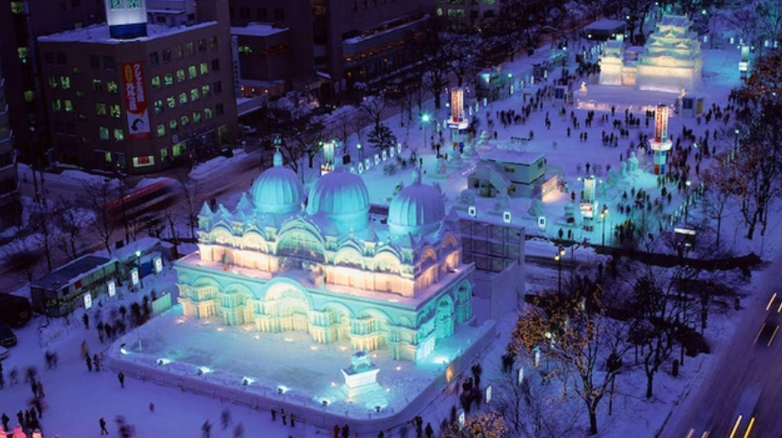  

겨울 홋카이도를 수놓는 세계적인 눈과 얼음의 제전

매년 2월 초, 홋카이도 삿포로 시내 곳곳에서 열리는 일본 최대의 겨울 축제입니다. 브라질 리우 카니발, 독일 옥토버페스트와 함께 세계 3대 축제 중 하나로 꼽히기도 합니다.

개최 시기: 매년 2월 초

개최 장소: 홋카이도 삿포로 (오도리 공원, 스스키노 등)

특징 및 매력:

세계 각국의 팀이 참여하여 만든 정교하고 거대한 눈 조각과 얼음 조각들이 도시를 가득 채웁니다.

밤이 되면 조각상들에 화려한 조명이 더해져 환상적인 야경을 연출하며, 다양한 겨울 먹거리와 액티비티도 즐길 수 있습니다.

### 2. 교토 기온 마츠리 (Gion Matsuri) 🎐  
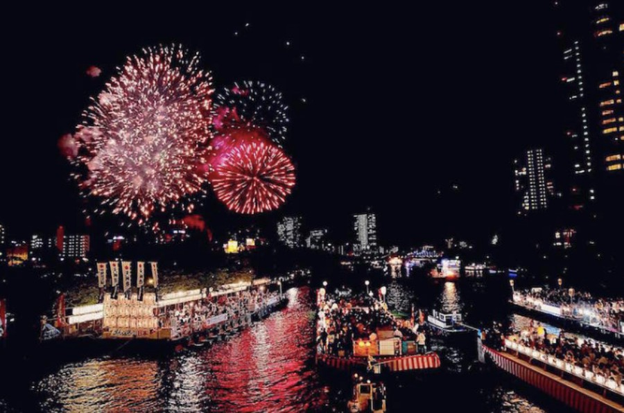  

천 년 고도 교토를 수놓는 아름답고 장엄한 여름 축제

매년 7월 한 달 동안 교토에서 열리며, 일본 3대 마츠리 중 하나로 꼽히는 역사 깊은 축제입니다. 9세기에 전염병을 퇴치하기 위해 시작된 것이 그 유래입니다.

개최 시기: 매년 7월 (한 달간)

개최 장소: 교토부 교토시 (야사카 신사 및 시내 일대)

특징 및 매력:

축제의 하이라이트는 7월 중순에 열리는 '야마보코 순행'으로, 화려하게 장식된 수십 대의 거대한 가마(야마보코)가 교토 시내를 행진하는 장관을 연출합니다.

전통 의상인 유카타를 입은 사람들과 밤거리를 밝히는 제등, 끊임없이 울려 퍼지는 전통 악기 소리가 어우러져 교토만의 짙은 감성을 선사합니다.

### 3. 오사카 텐진 마츠리 (Tenjin Matsuri) 🎆
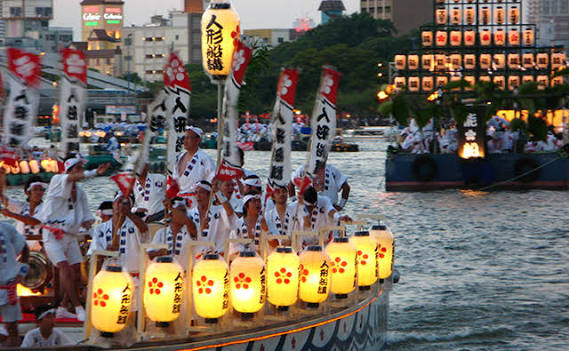  

물과 불이 어우러지는 화려한 오사카의 밤

교토의 기온 마츠리, 도쿄의 칸다 마츠리와 함께 일본 3대 마츠리로 불리는 오사카 최고의 여름 축제입니다. 학문의 신인 스가와라노 미치자네를 모시는 텐만구 신사를 중심으로 열립니다.

개최 시기: 매년 7월 24일 ~ 25일

개최 장소: 오사카부 오사카시 (오사카 텐만구 및 오카와 강 일대)

특징 및 매력:

수천 명의 사람들이 전통 의상을 입고 시내를 행진하는 '리쿠토교(육상 횡단)'와 수백 척의 배가 강을 거슬러 올라가는 '후나토교(해상 횡단)'가 일품입니다.

축제의 피날레인 25일 밤에는 오카와 강 위로 화려한 불꽃놀이가 펼쳐져 축제의 열기를 최고조로 끌어올립니다.

## 🧳 마무리 및 본인이 추천하는 코스

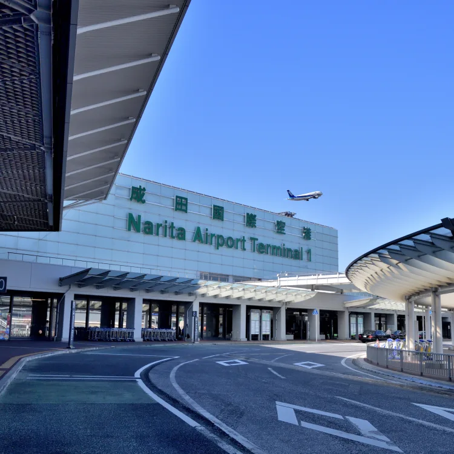  

일본은 짧은 비행시간으로 언제든 가볍게 떠날 수 있으면서도, 방문할 때마다 새로운 매력을 발견할 수 있는 다채로운 여행지입니다. 화려한 도심의 네온사인부터 고즈넉한 전통 사찰의 풍경, 그리고 오감을 사로잡는 미식과 열정적인 마츠리까지. 반복되는 일상에서 벗어나 특별한 휴식과 영감이 필요하다면 주저 없이 일본으로 향해보세요.

처음 일본을 방문하시거나, 먹거리와 전통 풍경을 짧은 시간 안에 모두 즐기고 싶은 분들을 위해 가장 만족도가 높은 **'오사카·교토 3박 4일 핵심 코스'** 를 추천합니다. 

| 일차 및 방문 지 | 추천 일정 | 핵심 포인트 |
| :--- | :--- | :--- |
| **1일 차 (오사카)** | 간사이 공항 도착 → 숙소 체크인 → 오사카성 → 도톤보리 & 신사이바시 | 도톤보리의 활기찬 분위기 속에서 **타코야키와 오코노미야키 맛보기**, 글리코상 앞에서 인증샷 남기기 |
| **2일 차 (교토)** | 오사카에서 교토로 당일치기 이동 → 후시미 이나리 신사 → 기요미즈데라(청수사) → 기온 거리 | 끝없이 이어지는 **붉은 도리이 길 걷기**, 고즈넉한 옛 도읍의 골목에서 쌉싸름한 말차 디저트 즐기기 |
| **3일 차 (오사카)** | 유니버설 스튜디오 재팬(USJ) **또는** 우메다 지역 쇼핑 & 야경 투어 | 취향에 맞춰 테마파크에서 에너지를 쏟거나, **우메다 스카이 빌딩 공중정원**에서 탁 트인 도심 야경 감상하기 |
| **4일 차 (마무리)** | 숙소 근처 산책 및 드럭스토어(돈키호테 등) 기념품 쇼핑 → 간사이 공항으로 이동 | 여행의 아쉬움을 달래며 장인의 비법이 담긴 **진한 돈코츠 라멘** 한 그릇으로 여정 마무리하기 |

이 추천 코스를 뼈대 삼아 여러분의 취향에 맞는 명소와 식당을 채워 넣으면 나만의 완벽한 여행 계획이 완성될 것입니다. 안전하고 즐거운 일본 여행이 되기를 바랍니다!

---

[← 전체 여행지 보기](../README.md)
